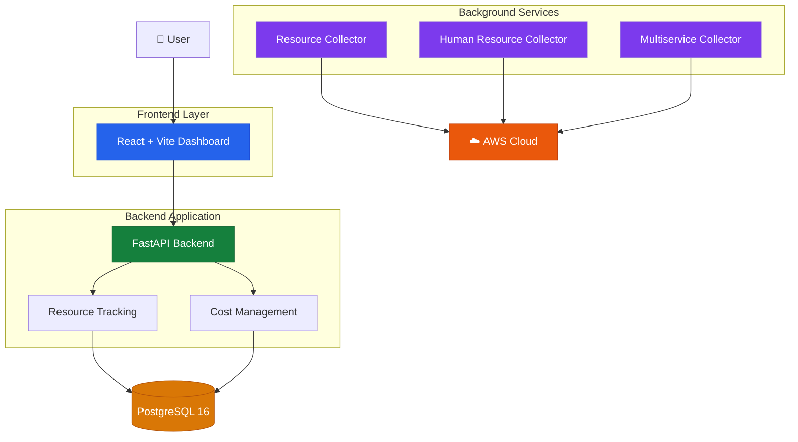

# ☁️ AWS FinOps Dashboard

### Cloud Cost Management | Resource Monitoring | Infrastructure Visibility

A centralized AWS FinOps platform for monitoring cloud infrastructure, tracking resources, and improving cloud cost visibility.


---

## 📌 Overview

**AWS FinOps Dashboard** is a cloud financial management application designed to bring cloud resource monitoring and cost management into one centralized platform.

The application uses React for the frontend, FastAPI for backend services, PostgreSQL for data storage, and Docker Compose for managing containers.

### 🎯 Project Objectives

- Improve visibility into AWS cloud resources.
- Centralize cloud cost management.
- Track cloud infrastructure information.
- Collect AWS resource data.
- Support infrastructure monitoring.
- Provide a scalable containerized architecture.

---

## ✨ Key Features

| Feature | Description |
|---------|-------------|
| ☁️ Cloud Cost Management | Manage and monitor cloud cost information |
| 📊 Resource Tracking | Track infrastructure resources and usage |
| 🔍 AWS Resource Collection | Collect AWS infrastructure information |
| 👥 Human Resource Collection | Dedicated human resource collection service |
| 🐳 Containerized Architecture | Independent services managed using Docker Compose |
| 🔐 Security Scanning | Vulnerability and configuration scanning using Trivy |
| 🗄️ Database Management | Persistent data storage using PostgreSQL |

---

## 🏗️ System Architecture

The following diagram represents the high-level application architecture.



---

## 🔄 Application Workflow

The application consists of multiple layers responsible for different operations.

| Layer | Component | Responsibility |
|-------|-----------|----------------|
| 01 | React Frontend | User interface and dashboard |
| 02 | FastAPI Backend | REST APIs and business logic |
| 03 | Resource Tracking | Infrastructure resource tracking |
| 04 | Cost Management | Cloud cost management |
| 05 | Background Collectors | Resource data collection |
| 06 | PostgreSQL | Persistent data storage |

### Workflow Explanation

1. The user accesses the React dashboard.
2. The frontend communicates with FastAPI through REST APIs.
3. The backend processes application requests.
4. Resource tracking manages infrastructure information.
5. Cost management handles cloud cost information.
6. Background collectors collect infrastructure data.
7. PostgreSQL stores application data.

---

## 🛠️ Technology Stack

| Technology | Purpose |
|------------|---------|
| React | Frontend framework |
| Vite | Frontend build tool |
| JavaScript | Frontend programming |
| Python | Backend programming |
| FastAPI | REST API framework |
| Uvicorn | Application server |
| PostgreSQL 16 | Database |
| Docker | Containerization |
| Docker Compose | Multi-container management |
| AWS | Cloud infrastructure |
| Trivy | Security scanning |
| Git | Version control |
| GitHub | Source code management |

---

## 📂 Project Structure

```text
aws-finops-dashboard/
│
├── backend/
│   ├── app/
│   │   ├── cost_management/
│   │   ├── routes/
│   │   ├── main.py
│   │   ├── resource_collector.py
│   │   ├── human_resource_collector.py
│   │   └── multiservice_collector.py
│   │
│   ├── migrations/
│   ├── Dockerfile
│   └── requirements.txt
│
├── frontend/
│   ├── public/
│   ├── src/
│   ├── package.json
│   └── vite.config.js
│
├── docker-compose.yml
├── docker-compose.cost-management.yml
├── docker-compose.resource-collector.yml
├── docker-compose.human-resource.yml
├── docker-compose.multiservice.yml
├── docker-compose.resource-test.yml
│
└── README.md
```

---

## ⚙️ Prerequisites

Before running the application, install:

- Git
- Docker
- Docker Compose
- Python 3.x (for local backend development)
- Node.js and npm (for local frontend development)

Verify Docker installation:

```bash
docker --version
```

Verify Docker Compose:

```bash
docker compose version
```

Verify Git:

```bash
git --version
```

---

## 🚀 Installation and Setup

### Step 1: Clone the Repository

```bash
git clone https://github.com/Shub0705/Aws_finOps_Dashboard.git
```

### Step 2: Navigate to the Project Directory

```bash
cd Aws_finOps_Dashboard
```

### Step 3: Check Project Files

```bash
ls -la
```

### Step 4: Start the Backend

Configure the required application environment variables before starting services.

```bash
docker compose up -d --build
```

### Step 5: Start Resource Collector

```bash
docker compose -f docker-compose.resource-collector.yml up -d --build
```

### Step 6: Start Human Resource Collector

```bash
docker compose -f docker-compose.human-resource.yml up -d --build
```

### Step 7: Check Running Containers

```bash
docker ps
```

### Step 8: View Application Logs

```bash
docker compose logs -f
```

---

## 🐳 Docker Deployment

The application uses Docker containers to separate backend services, collectors, and database components.

### Docker Services

| Service | Container Port | Host Port |
|---------|----------------|-----------|
| Backend API | 8000 | 8002 |
| Resource Test API | 8000 | 8003 (localhost) |
| PostgreSQL | 5432 | 5433 |
| Resource Collector | 8000 | Internal |
| Human Resource Collector | 8000 | Internal |

### Check Container Status

```bash
docker ps -a
```

### Check Docker Images

```bash
docker images
```

### Restart Services

```bash
docker compose restart
```

### Stop Main Compose Services

```bash
docker compose down
```

**Note:** Each additional Compose file manages its own configured services. Run `docker compose -f <filename> down` to stop a separately started stack.

---

## 🔐 Security and Vulnerability Scanning

This project uses **Trivy** to identify security vulnerabilities, misconfigurations, and exposed secrets.

### Scan Project Filesystem

```bash
trivy fs --scanners vuln,misconfig,secret .
```

### Scan Backend Directory

```bash
trivy fs --scanners vuln,misconfig,secret backend/
```

### Scan Docker Image

```bash
trivy image aws-finops-dashboard-backend
```

### Generate Security Report

```bash
trivy fs --scanners vuln,misconfig,secret \
  --format json \
  --output trivy-report.json .
```

**Security Note:** Never commit AWS access keys, passwords, `.env` files containing secrets, or private credentials to GitHub.

---

## 📊 Monitoring and Infrastructure Visibility

The platform is designed to improve cloud infrastructure visibility.

### Monitoring Areas

- AWS resource information
- Cloud cost information
- Infrastructure resource tracking
- Backend service availability
- Container status and logs
- Database connectivity

### Useful Docker Monitoring Commands

Check running containers:

```bash
docker ps
```

Monitor container resource usage:

```bash
docker stats
```

View backend logs:

```bash
docker compose logs -f
```

---

## 🔌 API Information

The backend application uses FastAPI to provide REST API endpoints.

### Example Local Endpoints

| Endpoint | Description |
|----------|-------------|
| `http://localhost:8002` | Backend API base URL |
| `http://localhost:8002/docs` | FastAPI Swagger documentation, if enabled |
| `http://localhost:8003` | Resource test API base URL |

**Note:** Actual API availability depends on running containers, port mappings, and application configuration.

---

## 🔮 Future Enhancements

The following improvements are planned:

- 📊 Advanced cloud cost analytics
- 💰 Automated cost optimization recommendations
- 🔔 Infrastructure monitoring and alerting
- ☁️ Cloud resource inventory reporting
- 🔐 Security and compliance dashboards
- 🔄 CI/CD pipeline integration
- 📈 Advanced reporting and visualization

---

## 📌 Project Status

**🚧 Development in Progress**

The AWS FinOps Dashboard is currently under active development.

The project focuses on improving AWS infrastructure visibility, cloud cost management, and containerized service management.

---

## 📚 Learning and Development

This project provides practical experience with:

- Full-stack application architecture
- REST API development
- Docker containerization
- Multi-service application deployment
- PostgreSQL database integration
- AWS cloud infrastructure
- Security vulnerability scanning
- Infrastructure monitoring concepts

---

## 🤝 Contributing

Contributions and suggestions are welcome.

1. Fork the repository.
2. Create a feature branch.
3. Make your changes.
4. Commit your changes.
5. Push your branch.
6. Open a pull request.

---

## 📄 License

MIT

---

<div align="center">

### ☁️ AWS FinOps Dashboard

**Cloud Visibility • Cost Optimization • Infrastructure Management**

Built using React, FastAPI, PostgreSQL, Docker, and AWS.

</div>
